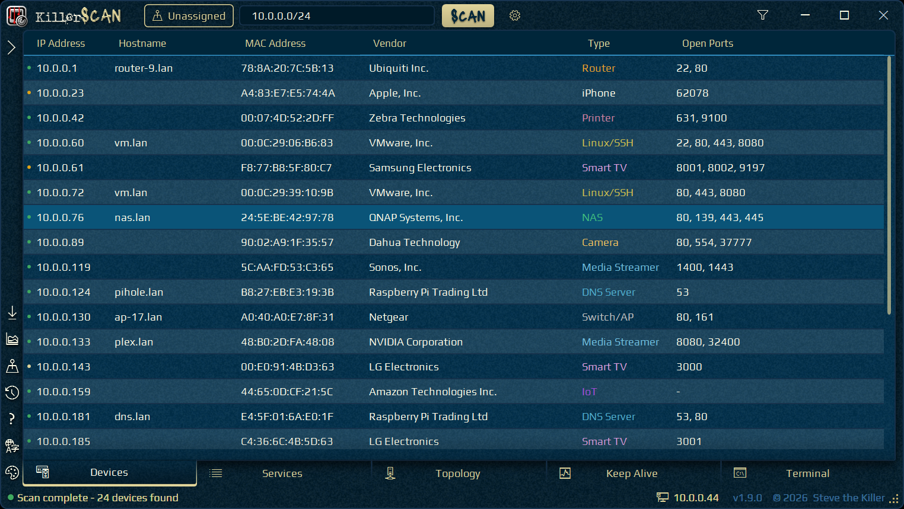
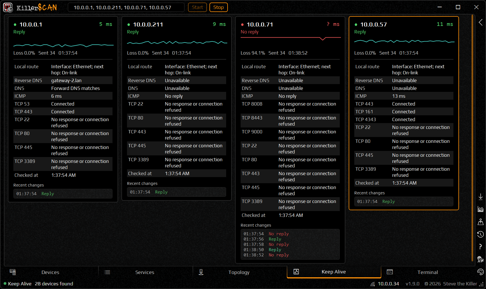

<p align="center">
  <a href="https://killerscan.net"></a>
</p>

One-click, fast network scanner built for field techs. Single portable EXE, free and open source under GPLv3.

Part of [killertools.net](https://killertools.net).

## Features

- **Discovery:** ARP cache, a parallel ping sweep and a second ARP pass, plus mDNS and SSDP for Chromecasts, printers, Sonos, AirPlay and NAS boxes. The target box takes several subnets, single hosts and ranges at once.
- **Fingerprinting:** TCP ports, HTTP title, SSH banner, TLS certificate, NetBIOS, SNMP and TTL feed a weighted-score classifier, with MAC vendors from the full IEEE registries. [Scan settings](docs/scan-options.md) choose which checks run.
- **Locations:** each customer site keeps its own saved scans, device names, approvals and history, picked from the Location button in the scan bar. [How Locations work](docs/locations.md).
- **Views:** Devices, Services, Topology, Keep Alive and Terminal, each keeping its own state. Topology exports as PNG, JPG or HTML containing SVG, and Keep Alive watches up to 16 devices with latency and loss.
- **Deep Scan** rescans every host or the selection across ports 1-1024 and more.
- **Scan history** compares earlier scans of the same target on the same network, with matching scan settings. Known-device baselines flag unfamiliar devices; approving a device is a separate choice.
- **Tools:** built-in PowerShell, ping and SSH terminals, device diagnostics, and a native speed test.
- **Command line** for scripts, RMM and KillerMCP, with JSON output and distinct exit codes.
- **Looks:** thirteen themes, 20 languages and app-wide sizing from 70% to 250%. Press F1 for every shortcut.

The [help page](https://killerscan.net/help.html) covers every view, tool and shortcut.

## Screenshots

KillerScan 1.9 preview.

<table>
<tr>
<td width="50%"><br><sub>Device discovery puts addresses, hostnames, MAC addresses, vendors, device types and open ports in one table.</sub></td>
<td width="50%"><br><sub>Keep Alive shows latency, packet loss, diagnostic checks and recent connection changes for each host.</sub></td>
</tr>
</table>

## Install

Windows 10 or 11 (x64) with .NET Framework 4.8, which Windows 10 version 1903 and later already include.

```powershell
winget install --id SteveTheKiller.KillerScan --exact
```

```powershell
choco install killerscan
```

Or download [KillerScan.exe](https://github.com/SteveTheKiller/KillerScan/releases/latest/download/KillerScan.exe) and run it. It offers to install for you, for all users, or not at all. The GPL source for this release is [KillerScan-1.8.3-src.zip](https://github.com/SteveTheKiller/KillerScan/releases/download/v1.9.1/KillerScan-1.9.1-src.zip). For managed removal and exit codes, see [deployment](docs/deployment.md).

## Build from source

```powershell
git clone https://github.com/SteveTheKiller/KillerScan.git
cd KillerScan
dotnet publish -c Release
```

Needs the .NET 10 SDK or later. Output lands in `bin/Release/net48/publish/`. Speed-test internals and tests are in [docs/speed-test.md](docs/speed-test.md).

## Privacy

KillerScan has no usage analytics and does not automatically upload scan results. Vendor lookup and classification run locally. Network connections include scans, diagnostics and device actions, vendor-database downloads, speed tests, and update checks at startup or from About. The startup update check can be disabled. HTML reports include their logo and work offline. Speed tests use generated data through `speed.killerscan.net`; Cloudflare sees your public IP and normal connection metadata. The website has its own analytics; this statement covers the app. The [technical page](https://killerscan.net/technical.html#speedtest-network) has the details.

## More

- [CHANGELOG.md](CHANGELOG.md)
- [TRANSLATING.md](TRANSLATING.md) for adding or improving a language
- [How it works](https://killerscan.net/technical.html): the scan pipeline, vendor resolution and the classifier

## License

GPLv3. See [LICENSE](LICENSE). Forks and redistributions must stay GPLv3 with source available.
